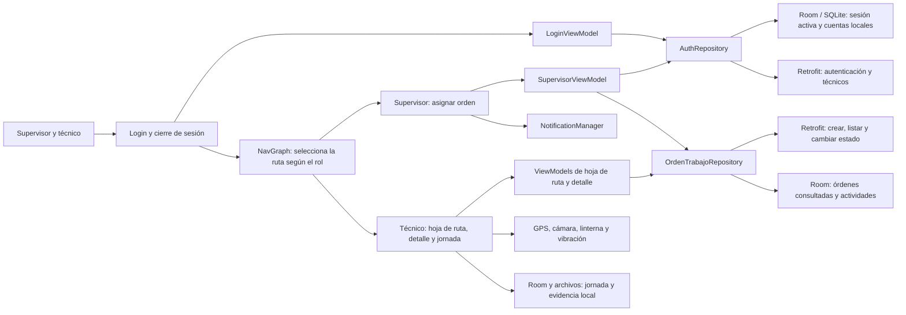
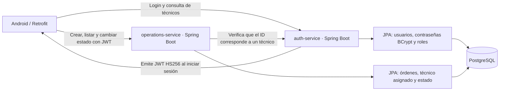

# Diagramas de arquitectura

Los diagramas muestran el flujo implementado para la Experiencia 3. Las acciones del supervisor y del técnico usan el mismo ID de usuario para relacionar la orden con su asignación.

## Aplicación Android y MVVM

## Microservicios y PostgreSQL

